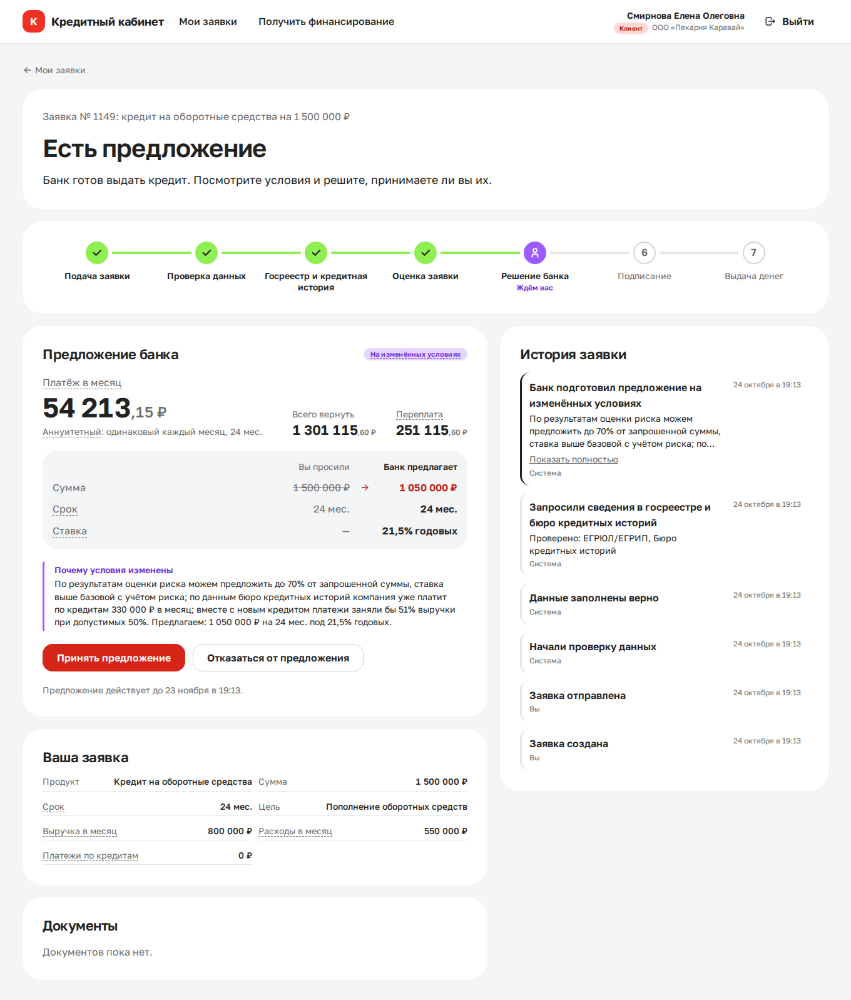

# Умный кредитный кабинет предпринимателя

Прототип кредитного конвейера для малого и микробизнеса, сделанный на хакатон Альфа-Банка.

Предприниматель подбирает кредит, подаёт заявку и видит, что с ней происходит и что ему делать дальше. Банк проверяет анкету, запрашивает госреестр и кредитную историю (здесь это локальные моки), считает скоринг и через несколько секунд присылает предложение, отказ или передаёт заявку специалисту. Специалист видит очередь, скоринг с объяснением каждого фактора и принимает решение. Клиент получает его без перезагрузки страницы.

Интерфейс открывается на http://localhost:3000. Войти можно в один клик под любой демо-учёткой из блока «Демо-доступ».



## Из чего состоит

```
docker compose
├── db             PostgreSQL 16 (volume db_data)
├── mock-external  моки ЕГРЮЛ/ЕГРИП и БКИ с режимами сбоя         :8001
├── backend        FastAPI: API, машина состояний, пайплайн         :8000
│                  миграции и демо-данные применяются при старте
└── frontend       React-интерфейс (nginx, /api → backend)          :3000
```

Подробнее: [архитектура](docs/architecture.md), [статусы заявки](docs/state-diagram.md), [модель данных](docs/data-model.md), [API](docs/api.md), [допущения](docs/assumptions.md), [исследование, MVP и тексты интерфейса](docs/research.md).

## Что нужно для запуска

Docker с Docker Compose v2 (Docker Desktop 4.x или Docker Engine 24+), около 2 ГБ свободной памяти и свободные порты 3000, 8000 и 8001. Интернет нужен только при первой сборке образов. Порты можно поменять в `.env` через `FRONTEND_PORT`, `BACKEND_PORT` и `MOCK_EXTERNAL_PORT`.

## Запуск

```bash
docker compose up --build
```

Первая сборка занимает 3–6 минут. Когда все контейнеры поднимутся, откройте http://localhost:3000. Миграции и демо-данные применяются сами, повторный запуск ничего не дублирует.

Swagger UI находится на http://localhost:8000/docs. Оформление страницы грузится с CDN, так что браузеру нужен интернет; сам API работает и без него, схема лежит в `docs/openapi.json`. Готовность сервиса показывает http://localhost:8000/api/v1/ready.

Чтобы начать с чистой базы:

```bash
docker compose down -v && docker compose up --build
```

## Переменные окружения

У всех настроек есть значения по умолчанию для демо прямо в `docker-compose.yml`, поэтому файл `.env` не обязателен. Если нужно что-то поменять, скопируйте образец (`cp .env.example .env`) и отредактируйте.

| Переменная | По умолчанию | Что задаёт |
|---|---|---|
| `JWT_SECRET` | демо-значение | Секрет подписи токенов. Вне демо его нужно сменить: при `APP_ENV=production` бэкенд с демо-секретом не запустится |
| `JWT_EXPIRE_MINUTES` | 60 | Срок жизни токена |
| `PIPELINE_STEP_DELAY_SECONDS` | 1.5 | Пауза между шагами обработки, чтобы на демо было видно смену статусов. 0 выключает паузы |
| `EXTERNAL_TIMEOUT_SECONDS` / `EXTERNAL_MAX_ATTEMPTS` / `EXTERNAL_BACKOFF_SECONDS` | 2 / 3 / 0.5 | Таймаут, число попыток и пауза при запросах к внешним сервисам |
| `MOCK_TIMEOUT_SLEEP_SECONDS` | 10 | Сколько мок «висит» в режиме сбоя `timeout` |
| `LOGIN_RATE_LIMIT_ATTEMPTS` / `LOGIN_RATE_LIMIT_WINDOW_SECONDS` | 5 / 60 | Ограничение неудачных попыток входа |
| `MAX_UPLOAD_MB` / `MAX_DOCUMENTS_PER_APPLICATION` / `ALLOWED_UPLOAD_EXTENSIONS` | 10 / 20 / pdf,jpg,jpeg,png | Ограничения загрузки документов |
| `PIPELINE_WATCHDOG_INTERVAL_SECONDS` / `PIPELINE_STUCK_AFTER_SECONDS` | 60 / 120 | Как часто сторож ищет застрявшие в обработке заявки и через сколько секунд считает заявку застрявшей |
| `CORS_ORIGINS` | http://localhost:5173 | Адреса фронтенда для разработки без Docker |
| `POSTGRES_DB` / `POSTGRES_USER` / `POSTGRES_PASSWORD` | credit_cabinet / credit / credit | База данных |
| `FRONTEND_PORT` / `BACKEND_PORT` / `MOCK_EXTERNAL_PORT` | 3000 / 8000 / 8001 | Порты на хосте |

Пояснения ко всем переменным есть в [.env.example](.env.example).

## Тестовые учётки

Пароль у каждой учётки строится одинаково: логин плюс `123`.

| Логин | Пароль | Компания | Что показывает |
|---|---|---|---|
| `employee` | `employee123` | сотрудник банка | Очередь заявок, карточка со скорингом, ручные решения, статистика |
| `client_good` | `client_good123` | ООО «Северный ветер» | Одобрение на запрошенных условиях, затем принятие, подписание и выдача |
| `client_medium` | `client_medium123` | ООО «Пекарня Каравай» | Высокая долговая нагрузка, заявку решает специалист. Он может предложить меньшую сумму |
| `client_border` | `client_border123` | ИП Сидоров П. А. | Пограничная оценка, заявку решает специалист |
| `client_bad` | `client_bad123` | ООО «Ромашка-Строй» | Компания ликвидируется и есть просрочка, отказ с причиной |
| `client_info` | `client_info123` | ИП Петрова М. И. | Нет выручки по отчётности, банк просит выписку, после неё даёт предложение |
| `client_timeout` | `client_timeout123` | ООО «ТехноСервис» | Бюро кредитных историй не отвечает, заявка уходит специалисту |
| `demo1` … `demo8` | `demo1123` … | фоновые компании | 8 заявок в разных статусах, чтобы очередь сотрудника не была пустой |

## Как проверить в браузере (5 минут)

1. Откройте http://localhost:3000 и в блоке «Демо-доступ» нажмите «Сильный заёмщик» (`client_good`).
2. На главной видны заявки, кнопка «Получить финансирование» и подсказки. Под каждой подсказкой написано, почему она показана.
3. Нажмите «Получить финансирование» и ответьте на 4 вопроса: цель «Пополнение оборотных средств», 1 500 000 ₽, 24 месяца. После «Подобрать продукт» у «Оборотного кредита» нажмите «Оформить заявку».
4. В анкете из 4 шагов параметры уже подставлены, данные компании тоже. На шаге с финансами введите выручку 800 000, расходы 550 000 и платежи по кредитам 0, затем отправьте заявку.
5. Дальше ничего не нажимайте. Страница сама обновляется каждые 3 секунды: статус проходит «Проверяем данные», «Проверяем компанию», «Оцениваем заявку» и останавливается на «Есть предложение».
6. Примите предложение, нажмите «Подписать договор» и отметьте согласие в окне с договором. Через пару секунд статус сменится на «Кредит выдан», а договор появится в «Документах».
7. Выйдите и отправьте ту же анкету под другими учётками. `client_bad` получит отказ с причиной, `client_info` попросят выписку (подойдёт любой PDF, после загрузки нажмите «Отправить уточнения»). Заявки `client_medium`, `client_timeout` и `client_border` уйдут специалисту.
8. Оставьте открытой заявку `client_border` в статусе «На рассмотрении у специалиста». Во втором окне (удобно в режиме инкогнито) войдите как «Сотрудник банка», нажмите «Ждут решения» и откройте эту заявку. Посмотрите скоринг и проверки, напишите комментарий и одобрите. В окне клиента предложение появится само.

Все сценарии с ожидаемыми результатами описаны в [docs/test-scenarios.md](docs/test-scenarios.md), скриншоты экранов лежат в [docs/screenshots/](docs/screenshots/).

## Как проверить через API

1. Откройте http://localhost:8000/docs.
2. В `POST /api/v1/auth/login` нажмите Try it out, отправьте `{"login": "client_good", "password": "client_good123"}`. Скопируйте `access_token`, нажмите Authorize вверху справа и вставьте токен.
3. Создайте заявку через `POST /api/v1/applications`:
   ```json
   {"product_code": "working_capital", "amount": 1500000, "term_months": 24, "purpose_code": "working_capital",
    "monthly_revenue": 800000, "monthly_expenses": 550000, "current_loan_payments": 0}
   ```
   Скопируйте `id` из ответа. Статус будет «Черновик», в `available_actions` есть «Отправить заявку».
4. Отправьте её: `POST /api/v1/applications/{id}/actions/submit`.
5. Повторяйте `GET /api/v1/applications/{id}`, пока статус не дойдёт до «Есть предложение». В `timeline` лежит история с пояснениями, в `offer` условия и платёж.
6. Вызовите `POST .../actions/accept_offer`, затем `POST .../actions/sign`. Через пару секунд статус станет «Кредит выдан».
7. Шаги 2–5 под другими учётками дают другой исход при той же анкете.
8. Под `employee` очередь открывается через `GET /api/v1/backoffice/applications?status=MANUAL_REVIEW`, карточка со скорингом через `GET /api/v1/backoffice/applications/{id}`, решение через `POST .../actions/approve` с телом `{"comment": "Одобряем"}`.

Для проверки без Swagger есть готовые коллекции запросов: [Postman](docs/requests/credit-cabinet.postman_collection.json) (импортируйте и запускайте папки по порядку, токены и id сохраняются сами) и [файл для VS Code REST Client](docs/requests/scenarios.http).

## Тесты

Бэкенд, юнит-тесты и e2e через API:

```bash
docker compose run --rm backend uv run pytest
```

Интерфейс, Playwright в Chromium. Команда поднимает весь стек и проходит сценарии всех учёток:

```bash
docker compose --profile e2e run --rm e2e
```

Обновить скриншоты в `docs/screenshots/`:

```bash
docker compose --profile e2e run --rm -e SCREENSHOTS=1 e2e npx playwright test --grep @screenshots
```

Бэкенд проверяют 183 теста, они идут около 20 секунд. Юнит-тесты покрывают машину состояний, каждый фактор скоринга, кредитное решение, аннуитетный платёж, ИНН, проверку анкеты и повторы запросов к внешним сервисам. E2E-тесты работают с отдельной базой `credit_cabinet_test` и настоящим mock-external: проходят сценарии всех учёток, ручное рассмотрение, права доступа, параллельные запросы и повторы действий. Рабочую базу тесты не трогают. Интерфейс проверяют 12 сценариев в браузере, это около минуты.

## Где лежат данные, которые меняет команда

Код для этого менять не нужно. Достаточно поправить файл и выполнить `docker compose up --build`, а для seed-данных ещё и `docker compose down -v` перед этим.

| Файл | Что внутри | Кто отвечает |
|---|---|---|
| `backend/config/products.yaml` | Продукты: лимиты, ставки, цели, обязательные поля; веса и тексты подбора продукта | участник 2 |
| `backend/config/scoring.yaml` | Факторы скоринга, диапазоны, баллы, объяснения, грейды, отраслевые группы риска | участник 2 |
| `backend/config/decision.yaml` | Стоп-факторы, решения и надбавки по грейдам, допустимая нагрузка, правила встречного предложения и запроса уточнений | участник 2 |
| `backend/config/dictionaries.yaml` | Цели кредита, виды документов, должности | участник 2 |
| `backend/config/labels.yaml` | Тексты для пользователя: статусы, кнопки, история, причины решений, этапы | участник 1 |
| `backend/config/contract_template.html` | Шаблон договора | участник 1 |
| `frontend/src/texts/glossary.ts` | Подсказки к банковским терминам в интерфейсе | участник 1 |
| `backend/config/feed.yaml` | Правила ленты подсказок | участник 3 |
| `backend/seed/companies.json`, `users.json` | Демо-компании и пользователи | участник 3 |
| `backend/seed/external_mocks.json` | Ответы моков ЕГРЮЛ и БКИ по ИНН, режимы сбоя | участник 3 |
| `backend/seed/applications.json` | Демо-история заявок для очереди сотрудника | участник 3 |
| `backend/seed/feed_items.json` | Подсказки и новости для ленты | участник 3 |

Места, где ждём данные коллег, помечены `TODO(участник N)`. Конфиги проверяются при старте. Если в них ошибка, бэкенд не запустится и напишет в логе, какое поле неверно.

## Фронтенд

Интерфейс написан на React 19, Vite и TypeScript с Mantine 9, TanStack Query и React Router. Цвета, шрифт Golos Text и скругления взяты из макетов команды в Figma и собраны в одном файле `frontend/src/theme.ts`.

Сам фронт ничего не решает. Кнопки берутся из `available_actions`, тексты статусов из `status_label` и `status_description`, шкала этапов из поля `progress`, история из `timeline`. Типы API генерируются из `docs/openapi.json`:

```bash
docker run --rm -v "$PWD:/w" -w /w/frontend node:22.23.4-alpine sh -c "npm ci && npm run gen:api"
```

В Docker фронт раздаёт nginx и проксирует `/api` на backend, поэтому браузер ходит на один адрес и CORS не нужен. Для разработки без Docker выполните `cd frontend && npm ci && npm run dev`: интерфейс откроется на http://localhost:5173, а `/api` будет проксироваться на :8000.

### API для интеграций

Базовый адрес `http://localhost:8000/api/v1`, CORS открыт для `http://localhost:5173`. Токен выдаёт `POST /auth/login`, дальше он передаётся в заголовке `Authorization: Bearer <access_token>`; `GET /auth/me` показывает, кто вошёл и с какой ролью. Схема доступна в Swagger и в файле [docs/openapi.json](docs/openapi.json).

Экран заявки строится из полей ответа: `status_label`, `status_description`, `available_actions` (подписи кнопок, активность, текст подтверждения), `progress`, `timeline`, `info_request` и `offer`. Пока заявка обрабатывается, её статус нужно опрашивать через `GET /applications/{id}`. Подробнее в [docs/api.md](docs/api.md).

## Структура репозитория

```
docker-compose.yml, .env.example     запуск
backend/                             API (FastAPI), миграции, конфиги и seed команды, тесты
  app/api | services | domain | integrations | models | schemas | core
  config/  seed/  alembic/  tests/
mock-external/                       моки ЕГРЮЛ/ЕГРИП и БКИ
frontend/                            интерфейс: src/pages (экраны), src/components, e2e (Playwright), theme.ts
docs/                                архитектура, API, сценарии, допущения, коллекции запросов
```

Сторонние библиотеки, образы и смоделированные интеграции перечислены в [THIRD_PARTY_NOTICES.md](THIRD_PARTY_NOTICES.md).
