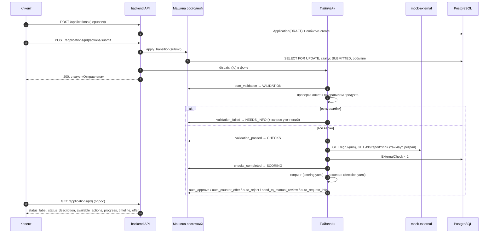

# Архитектура

## Компоненты


| Компонент | Что делает | Где код |
|---|---|---|
| `frontend` | Интерфейс клиента и сотрудника. nginx раздаёт статику и проксирует `/api` на backend | `frontend/src/` |
| `backend` | REST API, авторизация, машина состояний, пайплайн | `backend/app/` |
| `mock-external` | Имитация ЕГРЮЛ/ЕГРИП и БКИ с режимами сбоя | `mock-external/app/main.py` |
| `db` | PostgreSQL 16: заявки, события, проверки, скоринг, предложения | миграции `backend/alembic/` |
| конфиги команды | Продукты, скоринг, пороги решений, тексты, лента | `backend/config/`, `backend/seed/` |

### Слои бэкенда

```
app/api/           роутеры: принимают запрос, проверяют роль, вызывают сервис, возвращают схему
app/services/      сценарии: создание заявки, действия, пайплайн, бэкофис, документы, сборка ответов (presenters)
app/domain/        бизнес-логика без БД: машина состояний, проверка анкеты, скоринг, решение, платёж, подбор, лента, этапы
app/integrations/  клиенты внешних сервисов: интерфейс и HTTP-реализация
app/models/        таблицы SQLAlchemy
app/schemas/       входные и выходные схемы Pydantic
app/core/          настройки, БД, логи, ошибки, безопасность, загрузка конфигов
```

Скоринг, кредитное решение и проверка анкеты написаны как функции без обращения к базе и лежат в `domain/`. На вход они получают данные и конфиг, на выход отдают результат. Поэтому их просто читать и тестировать.

### Фронтенд

```
frontend/src/
  api/          клиент API (openapi-fetch) и типы, сгенерированные из docs/openapi.json
  auth/         вход, текущий пользователь, разведение ролей по маршрутам
  pages/        экраны: client/ (главная, подбор, анкета, заявка), bank/ (очередь, карточка, статистика)
  components/   общие блоки: шкала этапов, история, кнопки действий, предложение, документы, скоринг
  texts/        подсказки к терминам (glossary.ts), демо-учётки
  theme.ts      цвета, шрифт и скругления из Figma команды
```

Фронт показывает только то, что прислал бэкенд. Кнопки он берёт из `available_actions`, тексты статусов из `status_label` и `status_description`, шкалу этапов из `progress`, историю из `timeline`. Пока заявка не в финальном статусе, TanStack Query опрашивает её каждые 3 секунды. Решение пайплайна или сотрудника появляется у клиента без перезагрузки страницы. Браузер ходит на один адрес (:3000), а nginx проксирует `/api` на backend, так что CORS не нужен.

## Поток обработки заявки



Между шагами стоит пауза `PIPELINE_STEP_DELAY_SECONDS` (по умолчанию 1,5 с). Она нужна только на демо, чтобы смена статусов была видна глазами.

После решения процесс продолжается так. Клиент принимает предложение (`accept_offer`) и подписывает договор (`sign`), договор в HTML сохраняется как документ, а пайплайн переводит заявку в `ISSUED` событием `issue`. Клиент может и отказаться (`decline_offer`, статус `CLIENT_DECLINED`). Ответ на запрос уточнений (`provide_info`) снова запускает пайплайн. Если заявка в `MANUAL_REVIEW`, сотрудник выбирает одно из четырёх действий: `approve` (условия можно изменить), `counter_offer`, `request_info` или `reject`.

### Порядок кредитного решения (`app/domain/decision.py`)

1. Стоп-факторы: компания не найдена или ликвидируется, текущая просрочка больше N дней, бизнес моложе N месяцев. Итог: отказ.
2. Уточнения уже запрашивал сотрудник. После ответа клиента решение снова за ним. Проверки и скоринг всё равно пересчитываются, чтобы сотрудник видел свежие данные, а клиент не мог «поправить» анкету и обойти ручное рассмотрение.
3. Внешний сервис не ответил. Без полной картины решает человек, заявка уходит на ручное рассмотрение.
4. Не хватает данных: нет выручки по отчётности и нет выписки. Итог: запрос уточнений.
5. Грейд: A и B одобряются, C получает встречное предложение (70% суммы), D уходит специалисту, E получает отказ.
6. Если нагрузка по ставке предложения выше допустимой, система подбирает встречное предложение: сначала пробует дольше срок, потом меньшую сумму.

Ставка складывается из базовой ставки продукта и надбавки за грейд. Платёж аннуитетный.

## Решения и почему они такие

| Решение | Почему |
|---|---|
| Синхронный SQLAlchemy 2 и psycopg 3 | Джуниорам так проще читать код. FastAPI сам запускает sync-эндпоинты в пуле потоков |
| Машина состояний в одной таблице переходов | Все правила процесса в одном месте, диаграмма генерируется из кода, недопустимый переход даёт 409 |
| `SELECT ... FOR UPDATE` и `version` | Защищают от гонок: двойной клик, сотрудник и пайплайн одновременно. Проверено тестом с 5 параллельными запросами |
| Пайплайн «по статусам» | Каждый шаг делает один переход в своей транзакции, поэтому обработку можно перезапустить с любого места |
| Диспетчер с методом `dispatch(id)` | Сейчас за ним пул потоков. Если понадобится очередь, остальной код менять не придётся |
| Клиент интеграций не бросает исключений | Сбой БКИ считается штатной ситуацией: заявка уходит к специалисту и не падает |
| Бизнес-параметры в YAML/JSON с проверкой Pydantic | Коллеги меняют только конфиги. Опечатка в конфиге остановит запуск с понятной ошибкой и не всплывёт на демо |
| Тексты, кнопки и история приходят в ответе API | Фронт только отображает их, а тексты меняются в `labels.yaml` без правок кода |
| Логика решений в `domain/` без базы данных | Скоринг и решение тестируются без БД, вклад каждого фактора можно показать человеку |

## Безопасность

Токены JWT (HS256) живут ограниченное время, секрет берётся из окружения. При `APP_ENV=production` бэкенд с демо-секретом не запустится.

Пароли хранятся в bcrypt. Если логина нет, бэкенд всё равно проверяет пароль против хеша-заглушки, чтобы по времени ответа нельзя было узнать, какие логины существуют. После 5 неудачных попыток за 60 секунд на пару «IP + логин» вход отвечает 429.

Права проверяются на каждом эндпоинте. Клиент видит только заявки своей компании; на чужую заявку он получит 404, чтобы не узнать, что она существует. Бэкофис доступен только роли `employee`.

Загружать можно файлы только из белого списка расширений. Бэкенд сверяет сигнатуру содержимого с расширением, ограничивает размер и количество файлов, чистит имя файла и сохраняет его на диск под случайным именем в папке заявки. Скачивание идёт с `Content-Disposition: attachment` и `X-Content-Type-Options: nosniff`.

Логи пишутся в JSON с request id. Персональные данные (ФИО, ИНН, суммы) в логи не попадают, только идентификаторы и статусы. Значения параметров в ошибках SQL скрыты (`hide_parameters`), поэтому их нет и в трейсах. Access-лог uvicorn с IP-адресами отключён.

Контейнеры работают не от root, порт базы наружу не опубликован. Все входные данные проверяет Pydantic. Ошибки приходят в одном формате, `{"error": {"code", "message", "details"}}`, текст на русском.

## Надёжность и отказоустойчивость

У запросов к внешним сервисам есть таймаут на каждую попытку и до 3 попыток с растущей паузой. Ответы 4xx не повторяются. Если сервис так и не ответил, заявка уходит в `MANUAL_REVIEW`.

Неожиданная ошибка в шаге пайплайна переводит заявку в `MANUAL_REVIEW` через `technical_error`, так что она не зависает. При старте бэкенд возобновляет заявки, застрявшие в автоматических статусах, например после перезапуска контейнера. Кроме того, раз в минуту сторож ищет заявки, которые стоят в автоматическом статусе дольше 2 минут (упал поток, была недоступна база), и запускает их обработку заново.

Повтор только что выполненного действия (двойной клик, повтор после обрыва связи) возвращает текущее состояние без дублей событий. Если процесс уже ушёл дальше, повтор получает обычный 409.

У всех контейнеров есть healthcheck и `restart: unless-stopped`. `/api/v1/health` отвечает, жив ли процесс, а `/api/v1/ready` проверяет базу и mock-external.

Миграции и seed применяются при старте, и повторный запуск ничего не дублирует. Seed идёт под `pg_advisory_lock`, поэтому два экземпляра не загрузят данные дважды. Миграции при нескольких экземплярах нужно выносить в отдельную задачу деплоя, об этом ниже.

## Что нужно для продакшена

Бэкенд не хранит состояние у себя: заявки лежат в PostgreSQL, сессии в JWT. Чтобы запустить несколько экземпляров, нужно сделать следующее.

1. Заменить пул потоков очередью. Для этого достаточно реализовать `PipelineDispatcher` поверх RabbitMQ, Kafka или Redis Streams и вынести `run_pipeline` в отдельные воркеры. Пайплайн уже опирается на статус заявки, так что повторная доставка сообщения ничего не сломает.
2. Хранить файлы в S3-совместимом хранилище вместо volume `uploads` и отдавать их по подписанным ссылкам.
3. Перенести счётчик попыток входа из памяти процесса в Redis.
4. Запускать миграции отдельной задачей деплоя (job или init-container), а не при старте каждого экземпляра.
5. Брать секреты из хранилища секретов (Vault, KMS), включить TLS на входе и ограничить размер тела запроса на прокси.
6. Подключить сбор логов (ELK, Loki), добавить метрики и трассировку. Логи для этого уже в JSON с request id.
7. Подключить настоящие БКИ и ЕГРЮЛ через тот же интерфейс `ExternalDataClient` и добавить circuit breaker.
8. Сделать вход сотрудников через SSO банка (OIDC), refresh-токены для клиентов и роли шире, чем две.

## Что упрощено

Подробно упрощения перечислены в [`docs/assumptions.md`](assumptions.md). Главные из них: внешние сервисы заменены локальными моками, подписание и выдача денег имитируются, фоновая обработка идёт внутри процесса бэкенда, файлы лежат на локальном volume, счётчик попыток входа хранится в памяти, а все данные синтетические.
