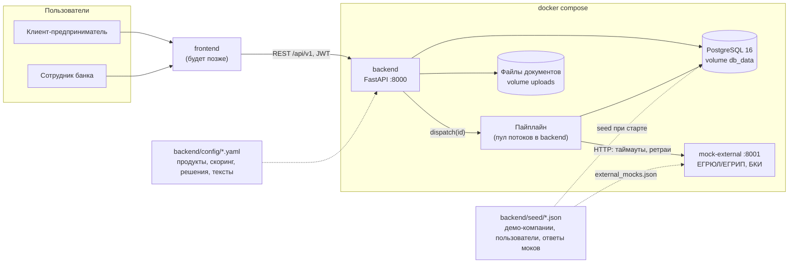
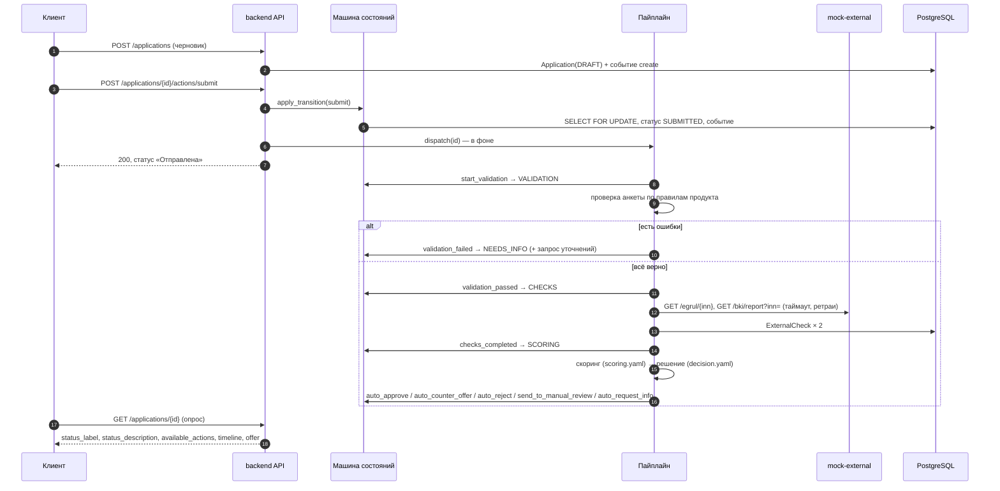

# Архитектура

## Компоненты



| Компонент | Что делает | Где код |
|---|---|---|
| `backend` | REST API, авторизация, машина состояний, пайплайн | `backend/app/` |
| `mock-external` | Имитация ЕГРЮЛ/ЕГРИП и БКИ с режимами сбоя | `mock-external/app/main.py` |
| `db` | PostgreSQL 16: заявки, события, проверки, скоринг, предложения | миграции `backend/alembic/` |
| конфиги команды | Продукты, скоринг, пороги решений, тексты, лента | `backend/config/`, `backend/seed/` |

### Слои бэкенда

```
app/api/           роутеры: принимают запрос, проверяют роль, вызывают сервис, возвращают схему
app/services/      сценарии: создание заявки, действия, пайплайн, бэкофис, документы, сборка ответов (presenters)
app/domain/        чистая бизнес-логика без БД: машина состояний, проверка анкеты, скоринг, решение, платёж, подбор, лента
app/integrations/  клиенты внешних сервисов: интерфейс + HTTP-реализация
app/models/        таблицы SQLAlchemy
app/schemas/       входные и выходные схемы Pydantic
app/core/          настройки, БД, логи, ошибки, безопасность, загрузка конфигов
```

Правило: бизнес-решения (скоринг, кредитное решение, проверка анкеты) — чистые функции в `domain/`. Их легко
проверить юнит-тестами и легко читать: на вход данные и конфиг, на выход результат.

## Поток обработки заявки



Пауза между шагами (`PIPELINE_STEP_DELAY_SECONDS`, по умолчанию 1,5 с) нужна только для демо — чтобы было видно, как меняется статус.

После решения:
- клиент: `accept_offer` → `sign` (договор HTML сохраняется документом) → пайплайн: `issue` → `ISSUED`;
- клиент: `decline_offer` → `CLIENT_DECLINED`; `provide_info` → снова пайплайн;
- сотрудник в `MANUAL_REVIEW`: `approve` (можно изменить условия) / `counter_offer` / `request_info` / `reject`.

### Порядок кредитного решения (`app/domain/decision.py`)

1. Стоп-факторы (компания не найдена/ликвидируется, текущая просрочка > N дней, бизнес моложе N мес.) → отказ.
2. Уточнения по заявке запрашивал сотрудник → после ответа клиента решение снова за сотрудником (проверки и скоринг
   пересчитываются, чтобы он видел свежую картину; «поправить» анкету и обойти ручное рассмотрение нельзя).
3. Внешний сервис не ответил → ручное рассмотрение (без полной картины решает человек).
4. Не хватает данных (нет выручки по отчётности и нет выписки) → запрос уточнений.
5. Грейд: A, B — одобрение; C — встречное предложение (70% суммы); D — ручное рассмотрение; E — отказ.
6. Нагрузка (по ставке предложения) выше допустимой → встречное предложение: сначала дольше срок, потом меньше сумма.

Ставка = базовая ставка продукта + надбавка по грейду. Платёж — аннуитетный.

## Решения и обоснование

| Решение | Почему |
|---|---|
| Синхронный SQLAlchemy 2 + psycopg 3 | Проще читать джуниорам; FastAPI сам запускает sync-эндпоинты в пуле потоков |
| Машина состояний — одна таблица переходов | Все правила процесса видны в одном месте; диаграмма генерируется из кода; недопустимый переход — 409 |
| `SELECT ... FOR UPDATE` + `version` | Защита от гонок: двойной клик, сотрудник и пайплайн одновременно (проверено тестом с 5 параллельными запросами) |
| Пайплайн «по статусам» | Каждый шаг — один переход в своей транзакции; обработку можно безопасно перезапустить с любого места |
| Диспетчер с методом `dispatch(id)` | Сейчас пул потоков, позже — очередь, без изменений в остальном коде |
| Клиент интеграций никогда не бросает исключение | Сбой БКИ — штатная ситуация: заявка уходит к специалисту, а не падает |
| Бизнес-параметры в YAML/JSON с проверкой Pydantic | Коллеги меняют только конфиги; опечатка в конфиге остановит запуск с понятной ошибкой, а не всплывёт на демо |
| Ответ API содержит тексты, кнопки и таймлайн | Фронт только отображает; тексты меняются в `labels.yaml` без правок кода |
| Чистые функции в `domain/` | Скоринг и решение тестируются без БД; логика объяснима (вклад каждого фактора) |

## Безопасность

- JWT (HS256) с истечением срока; секрет из окружения; в `APP_ENV=production` запуск с демо-секретом запрещён.
- Пароли — bcrypt; при неизвестном логине всё равно проверяется хеш-заглушка (нет утечки логинов по времени ответа).
- Ограничение попыток входа: 5 неудачных за 60 секунд на пару «IP + логин» → 429.
- Проверка прав на каждом эндпоинте: клиент видит только заявки своей компании (чужая заявка → 404, чтобы не раскрывать её
  существование), бэкофис — только `employee`.
- Загрузка файлов: белый список расширений, проверка сигнатуры содержимого, лимит размера и количества файлов, очистка имени, файл на диске
  получает случайное имя внутри папки заявки, скачивание — `Content-Disposition: attachment` и `X-Content-Type-Options: nosniff`.
- Логи в JSON с request id; персональные данные (ФИО, ИНН, суммы) в логи не пишутся — только id и статусы.
  Access-лог uvicorn с IP-адресами отключён.
- Контейнеры работают не от root; порт БД наружу не публикуется.
- Валидация всех входных данных — Pydantic; единый формат ошибок `{"error": {"code", "message", "details"}}` на русском.

## Надёжность и отказоустойчивость

- Внешние сервисы: таймаут на попытку, до 3 попыток с экспоненциальной паузой, 4xx не повторяются. После неудачи — `MANUAL_REVIEW`.
- Неожиданная ошибка в шаге пайплайна → `technical_error` → `MANUAL_REVIEW`, заявка не «зависает».
- При старте бэкенд возобновляет заявки, застрявшие в автоматических статусах (например, после перезапуска контейнера).
- Идемпотентность: повтор только что выполненного действия (двойной клик, повтор после обрыва связи) возвращает текущее
  состояние без дублей событий; если процесс уже ушёл дальше, повтор получает обычный 409.
- Сторож пайплайна: раз в минуту ищет заявки, которые больше 2 минут стоят в автоматическом статусе (упал поток, база
  была недоступна), и возобновляет их обработку. При старте бэкенда возобновляются все прерванные заявки.
- Healthchecks у всех контейнеров, `restart: unless-stopped`; `/api/v1/health` (liveness) и `/api/v1/ready` (БД + mock-external).
- Миграции и seed — автоматически при старте и идемпотентно. Seed выполняется под `pg_advisory_lock` (два экземпляра не
  загрузят данные дважды); миграции при нескольких экземплярах нужно запускать отдельной задачей деплоя (см. ниже).

## Масштабирование: что нужно для продакшена

Бэкенд stateless: состояние заявок — в PostgreSQL, сессии — в JWT. Чтобы запустить несколько экземпляров, нужно:

1. **Очередь вместо пула потоков.** Реализовать `PipelineDispatcher` поверх RabbitMQ/Kafka/Redis Streams, вынести
   `run_pipeline` в отдельные воркеры. Пайплайн уже идемпотентен по статусу — повторная доставка сообщения безопасна.
2. **Объектное хранилище для файлов** (S3-совместимое) вместо volume `uploads`; скачивание — через подписанные ссылки.
3. **Общее хранилище для rate limit** (Redis) вместо памяти процесса.
4. **Миграции — отдельной задачей деплоя** (job/init-container), а не при старте каждого экземпляра.
5. **Секреты из хранилища секретов** (Vault/KMS), TLS на входе, лимит размера тела запроса на прокси.
6. **Наблюдаемость:** логи уже в JSON с request id — подключить сбор (ELK/Loki), добавить метрики и трассировку.
7. **Интеграции** с настоящими БКИ/ЕГРЮЛ через тот же интерфейс `ExternalDataClient` + circuit breaker.
8. **Авторизация** через SSO банка (OIDC) для сотрудников, refresh-токены для клиентов, ролевая модель шире двух ролей.

## Что упрощено

См. [`docs/assumptions.md`](assumptions.md). Главное: внешние сервисы — локальные моки, подписание и выдача — имитация,
фоновая обработка — в процессе бэкенда, файлы — на локальном volume, rate limit — в памяти, данные — синтетические.
