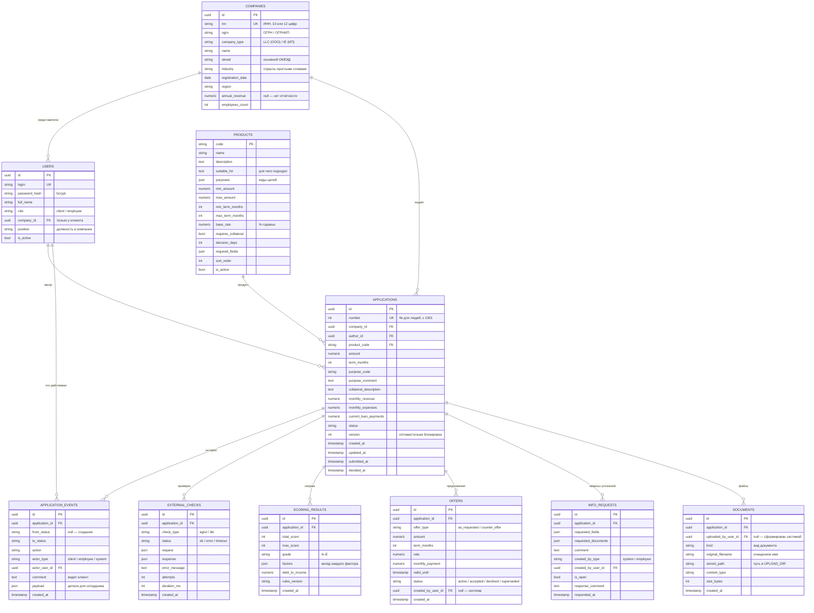

# Модель данных

Модели SQLAlchemy — в [`backend/app/models/`](../backend/app/models/), миграции — в [`backend/alembic/versions/`](../backend/alembic/versions/).
Все первичные ключи — UUID (кроме продукта: у него постоянный код). Деньги — `NUMERIC(16,2)`.

## Пояснения

- **`applications.version`** увеличивается при каждом изменении (SQLAlchemy `version_id_col`). Клиент может передать
  `version` в `PATCH` и в действиях — если заявку уже изменили, получит 409.
- **`application_events`** — одновременно аудит (кто, когда, из какого статуса в какой, с какими деталями) и таймлайн для клиента.
  `comment` показывается клиенту, `payload` (коды причин решения, статусы проверок, условия предложения) — только сотруднику.
- **Повторная обработка** (после `provide_info`) создаёт новые записи `external_checks` и `scoring_results`;
  карточка сотрудника показывает последние. Новые предложения помечают старые как `superseded`.
- **Продукты** синхронизируются из `config/products.yaml` при каждом старте; удалённый из конфига продукт становится `is_active = false`.
- **Файлы документов** лежат в volume `uploads` (`UPLOAD_DIR/<id заявки>/<случайное имя>`), в БД — только метаданные.
