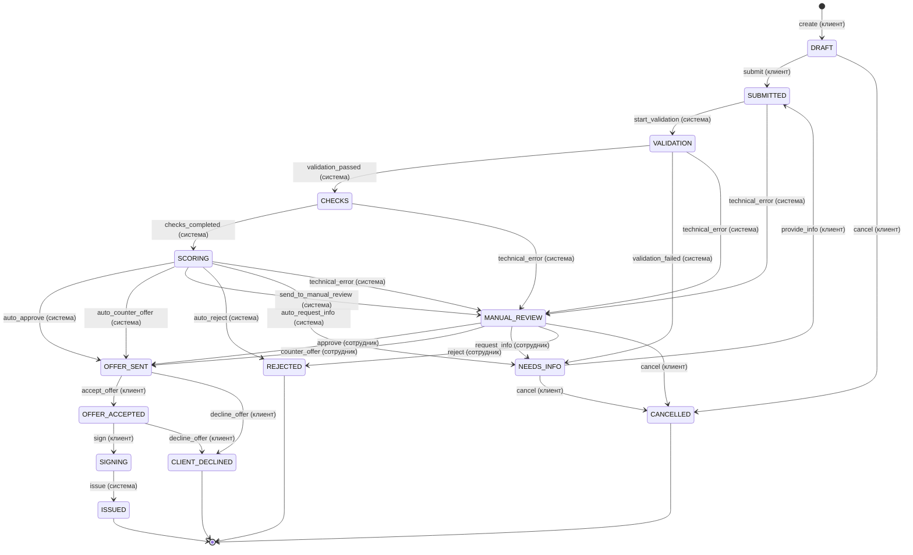

# Диаграмма состояний заявки

Все переходы описаны в таблице `TRANSITIONS` в [`backend/app/domain/state_machine.py`](../backend/app/domain/state_machine.py), и диаграмма ниже сгенерирована из неё. Статус меняется только через `apply_transition()`. Эта функция блокирует строку заявки (`SELECT ... FOR UPDATE`), проверяет переход, роль и предусловие и в той же транзакции записывает `ApplicationEvent`. На недопустимый переход API отвечает `409 Conflict` с понятным сообщением.

## Статусы

| Статус | Для клиента (`status_label`) | Кто действует | Что происходит |
|---|---|---|---|
| `DRAFT` | Черновик | клиент | Заполняет анкету, может редактировать и загружать документы |
| `SUBMITTED` | Отправлена | система | Заявка в очереди на автоматическую обработку |
| `VALIDATION` | Проверяем данные | система | Полнота анкеты, лимиты продукта, ИНН, разумность цифр |
| `NEEDS_INFO` | Нужны уточнения | клиент | Исправляет анкету / загружает документы, затем `provide_info` |
| `CHECKS` | Проверяем компанию | система | ЕГРЮЛ/ЕГРИП и БКИ (таймауты, ретраи) |
| `SCORING` | Оцениваем заявку | система | Скоринг и кредитное решение |
| `MANUAL_REVIEW` | На рассмотрении у специалиста | сотрудник | Пограничный грейд или сбой внешнего сервиса |
| `OFFER_SENT` | Есть предложение | клиент | Принять или отказаться |
| `OFFER_ACCEPTED` | Предложение принято | клиент | Подписать договор (или отказаться) |
| `SIGNING` | Подписание | система | Имитация выдачи средств |
| `ISSUED` | Кредит выдан | никто | Финал |
| `REJECTED` | Отказ | никто | Финал, причина видна в карточке статуса и в истории |
| `CLIENT_DECLINED` | Отказ от предложения | никто | Финал |
| `CANCELLED` | Заявка отозвана | никто | Финал |

Тексты статусов и кнопок лежат в [`backend/config/labels.yaml`](../backend/config/labels.yaml).

## Предусловия и правила

`provide_info` недоступен, пока клиент не загрузил документы, которые запросил банк. Кнопка при этом приходит с `enabled: false` и `disabled_reason`. `accept_offer` недоступен, если у предложения истёк срок.

Каждое действие сотрудника (`approve`, `counter_offer`, `request_info`, `reject`) требует комментарий, и клиент его видит. Анкету (`PATCH`) можно править и документы загружать только в `DRAFT` и `NEEDS_INFO`; в `available_actions` эти возможности приходят как `edit` и `upload_document`.

Если пользователь повторил только что выполненное действие, а заявка ещё в статусе, куда её привело это действие, или в автоматической обработке после него, API вернёт текущее состояние (200) без дублей в истории. Когда процесс уже дошёл до нового решения, повтор считается недопустимым переходом (409).

Если уточнения запросил сотрудник, ответ клиента (`provide_info`) снова проходит проверки, но итоговое решение возвращается к сотруднику (`send_to_manual_review`). Исключение составляют стоп-факторы, по ним отказ автоматический.
