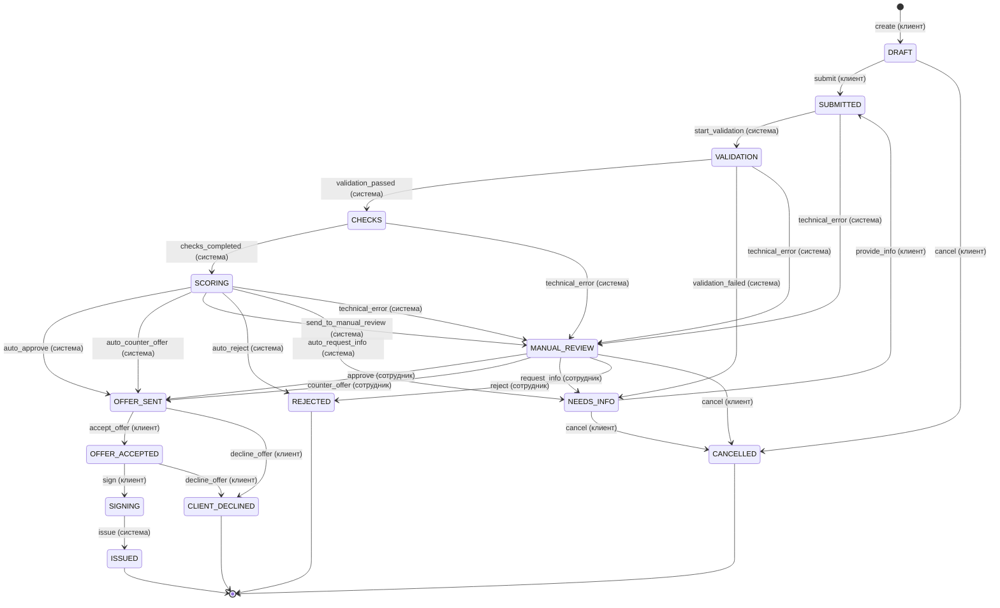

# Диаграмма состояний заявки

Источник истины — таблица `TRANSITIONS` в [`backend/app/domain/state_machine.py`](../backend/app/domain/state_machine.py).
Диаграмма ниже сгенерирована из неё. Любая смена статуса идёт только через `apply_transition()`: строка заявки
блокируется (`SELECT ... FOR UPDATE`), проверяются переход, роль и предусловие, и в той же транзакции пишется `ApplicationEvent`.
Недопустимый переход → `409 Conflict` с понятным сообщением.

## Статусы

| Статус | Для клиента (`status_label`) | Кто действует | Что происходит |
|---|---|---|---|
| `DRAFT` | Черновик | клиент | Заполняет анкету, может редактировать и загружать документы |
| `SUBMITTED` | Отправлена | система | Заявка в очереди на автоматическую обработку |
| `VALIDATION` | Проверяем данные | система | Полнота анкеты, лимиты продукта, ИНН, разумность цифр |
| `NEEDS_INFO` | Нужны уточнения | клиент | Исправляет анкету / загружает документы, затем `provide_info` |
| `CHECKS` | Запрашиваем сведения | система | ЕГРЮЛ/ЕГРИП и БКИ (таймауты, ретраи) |
| `SCORING` | Оцениваем заявку | система | Скоринг и кредитное решение |
| `MANUAL_REVIEW` | На рассмотрении у специалиста | сотрудник | Пограничный грейд или сбой внешнего сервиса |
| `OFFER_SENT` | Есть предложение | клиент | Принять или отказаться |
| `OFFER_ACCEPTED` | Предложение принято | клиент | Подписать договор (или отказаться) |
| `SIGNING` | Подписание | система | Имитация выдачи средств |
| `ISSUED` | Кредит выдан | — | Финал |
| `REJECTED` | Отказ | — | Финал; причина в истории заявки |
| `CLIENT_DECLINED` | Отказ от предложения | — | Финал |
| `CANCELLED` | Заявка отозвана | — | Финал |

Тексты статусов и кнопок — в [`backend/config/labels.yaml`](../backend/config/labels.yaml).

## Предусловия и правила

- `provide_info` недоступен, пока не загружены документы, которые запросил банк (кнопка приходит с `enabled: false` и `disabled_reason`).
- `accept_offer` недоступен, если у предложения истёк срок действия.
- Действия сотрудника (`approve`, `counter_offer`, `request_info`, `reject`) требуют комментарий — его видит клиент.
- Редактирование анкеты (`PATCH`) и загрузка документов — только в `DRAFT` и `NEEDS_INFO` (в `available_actions` это `edit` и `upload_document`).
- Повтор уже выполненного действия тем же пользователем возвращает текущее состояние (200), а не ошибку.
